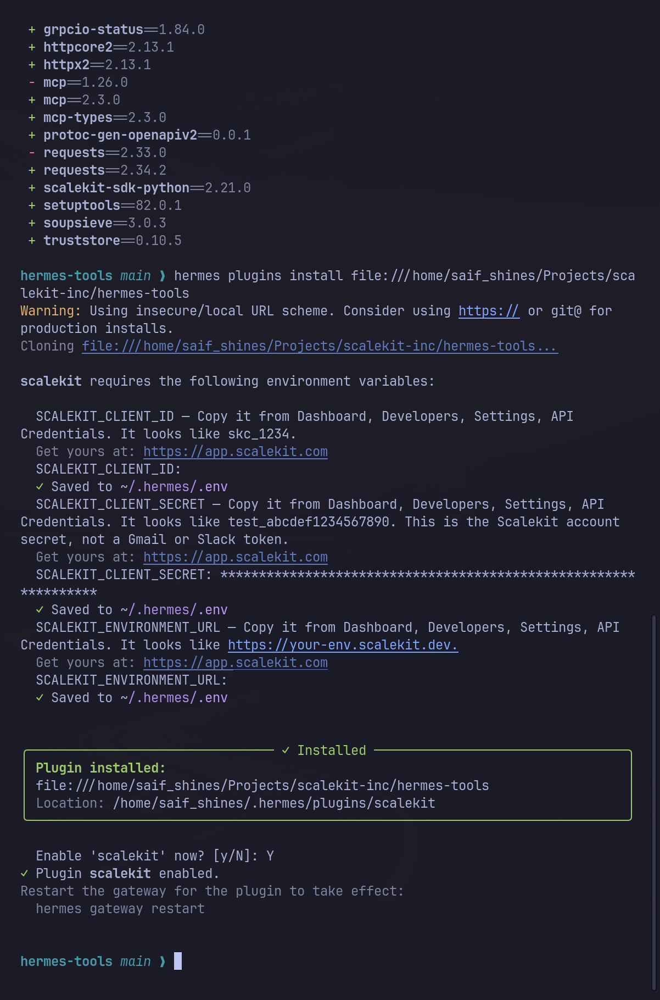
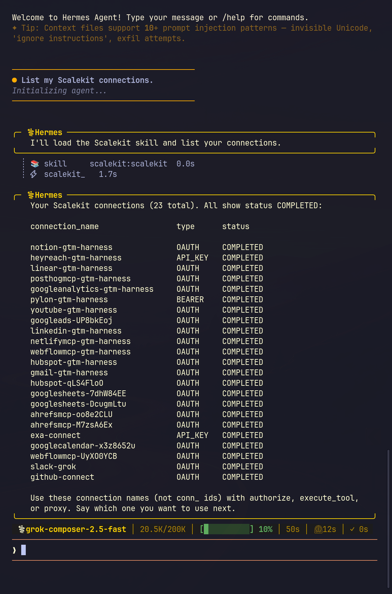
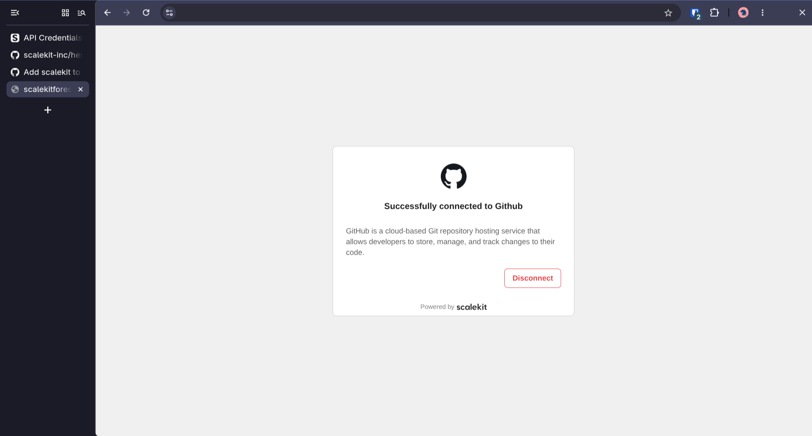
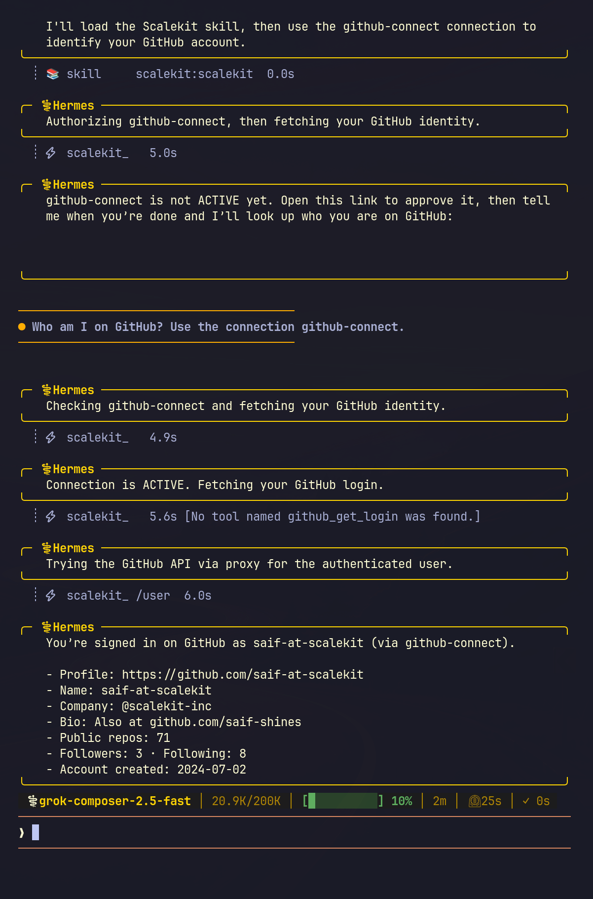

# Connect Hermes Agent to 500+ connectors and 20k+ tools

Hermes can call the Scalekit catalog: 500+ connectors and 20,000+ tools, as published on [scalekit.com](https://www.scalekit.com/). Scalekit stores each person's token and refreshes it. You paste three Scalekit account values once. You do not paste a Gmail, Slack, or GitHub token into Hermes.

- **Four tools cover the catalog.** `scalekit_list_connections`, `scalekit_authorize`, `scalekit_execute_tool`, `scalekit_proxy`.
- **One install command.** `hermes plugins install scalekit-inc/hermes-tools`.
- **The key prompt is the install.** Hermes asks for the three values and saves them to `~/.hermes/.env`.
- **A finished dashboard connection is not your approval.** The first ask for a new person returns an approval link. After you approve, the same ask returns the profile.
- **The reply has no provider token.**

## Install

These commands were run on Hermes 0.19.0. Quit any open `hermes` chat first.

```bash
hermes --version
```

Hermes 0.19.0 does not install plugin dependencies. `python -m pip` fails on that Hermes because it has no `pip` module. This command reads the Python path from the first line of the `hermes` program and installs the Scalekit package there:

```bash
uv pip install --python "$(sed -n '1s/^#!//p' "$(command -v hermes)")" 'scalekit-sdk-python>=2.12.0,<3'
```

On the test machine that Python was `~/.local/share/mise/installs/pipx-hermes-agent/0.19.0/hermes-agent/bin/python`. The package that installed was `scalekit-sdk-python` 2.21.0.

Run this step on a current Hermes too. The Scalekit package needs the `setuptools` library below version 83. Hermes pins `setuptools` 83. Those two pins cannot sit in one environment, so the plugin leaves this install to you.

```bash
hermes plugins install scalekit-inc/hermes-tools
```

`hermes plugins install scalekit` fails until the Hermes catalog lists this plugin.

If Hermes says the plugin is already installed, replace that copy:

```bash
hermes plugins install scalekit-inc/hermes-tools --force
```

Hermes then asks for three values. Paste them from [app.scalekit.com](https://app.scalekit.com) → Dashboard → Developers → Settings → API Credentials. If Hermes does not ask, those values are already saved.

| Prompt | What you paste |
|---|---|
| `SCALEKIT_CLIENT_ID` | The client id. It looks like `skc_1234`. A production id can start with `prd_skc_`. |
| `SCALEKIT_CLIENT_SECRET` | The client secret. It looks like `test_abcdef1234567890`. This is the Scalekit account secret, not a Gmail or Slack token. |
| `SCALEKIT_ENVIRONMENT_URL` | The environment URL. It looks like `https://your-env.scalekit.dev`. |

When Hermes asks `Enable 'scalekit' now?`, type `Y`. The tools show up in the next `hermes` chat. Restart the gateway only if a gateway is already running.



Before you install, open [app.scalekit.com](https://app.scalekit.com) → AgentKit → Connections, and write down a connection name. The test used `github-connect`. Its type was `OAUTH` and its status was `COMPLETED`. Do not copy a `conn_` id.

## Try it

```text
List my Scalekit connections.
```

```text
Who am I on GitHub? Use the connection github-connect.
```

Use your own connection name.

## What to expect

1. **The list names each connection.** You see the name, the type, and the status. In the test, the list had 23 connections, all `COMPLETED`, and `github-connect` was `OAUTH`.

   

2. **The first ask for a new person returns an approval link.** Open the link. The page says **Successfully connected to Github.** Send the same sentence again. A scheduled job returns the link and stops. Approve the app in a normal chat first.

   

3. **The next ask is ACTIVE.** The reply has the login, the name, and the profile URL. In the test that was `saif-at-scalekit` and `https://github.com/saif-at-scalekit`. The reply has no token.
4. **A guessed tool name is refused.** Hermes tried `github_get_login`. Scalekit has no tool by that name. Hermes then called `scalekit_proxy` on `/user` and returned the profile.

   
5. **The plugin creates the person id.** The first launch may print `Scalekit identifier created: usr_…`. You do not type it. An update keeps that id, so an approval you already gave stays `ACTIVE`.

## Tools

| Tool | What it does |
|---|---|
| `scalekit_list_connections` | Lists the connections in your Scalekit account. |
| `scalekit_authorize` | Returns an approval link, or `ACTIVE` when this person already approved the connection. |
| `scalekit_execute_tool` | Calls one named tool after the account is `ACTIVE`. |
| `scalekit_proxy` | Calls one HTTP path when the connector has no named tool. |

The rules Hermes reads are in the bundled skill `scalekit:scalekit`, which you open before the first Scalekit action, and in `scalekit:hermes-delegated-auth`.

<details>
<summary>Disclosure</summary>

- **Network:** the plugin's HTTP calls go to the environment URL you paste. That call lists connections, asks Scalekit for an approval link, runs a named tool, or proxies one HTTP request. You open the approval link in your browser.
- **Credentials:** install saves the three Scalekit values in the Hermes home `.env`. The plugin reads them with Hermes `get_secret`. Provider tokens stay in Scalekit. The chat reply leaves them out.
- **Stored data:** one person id at `<HERMES_HOME>/plugin-data/scalekit/identifier`. Hermes keeps that directory when you update or remove the plugin. If `plugin-data/hermes-tools/identifier` already exists, the plugin reads that file and copies the id.
- **Where the tools run:** after you enable the plugin, the four tools are on every Hermes surface that shares the tool registry, including a messaging gateway. A person that gateway admits can ask Hermes to call them with your Scalekit values.
- The plugin starts no shell command, no background process, and no telemetry. It does not replace its own files. A scheduled run returns the approval link and stops.

</details>

<details>
<summary>Tips</summary>

- Manage every connector at [app.scalekit.com](https://app.scalekit.com) → AgentKit → Connections. Add the connector there, then tell Hermes the connection name, such as `github-connect`.
- Create the Scalekit account in the dashboard. Copy the three API values from [app.scalekit.com](https://app.scalekit.com) → Dashboard → Developers → Settings → API Credentials. The install prompt is where those values go.
- Cursor, Claude Code, Copilot, and Codex keep using authstack, including the skill `hermes-delegated-auth`. Hermes uses this plugin and the skill `scalekit:scalekit`.
- The four tools cover every connector in the account. Ask in a sentence. Hermes picks list, authorize, a named tool, or the proxy.
- A file from the proxy comes back in the chat. Save it from the reply when you want the file on disk.

</details>

## Development

```bash
python -m pytest tests
hermes plugins validate . --install-deps
hermes plugins doctor . --ci
```

The tests use a fake Scalekit client and send no requests.

Install a local checkout with:

```bash
hermes plugins install "file://$PWD"
```
